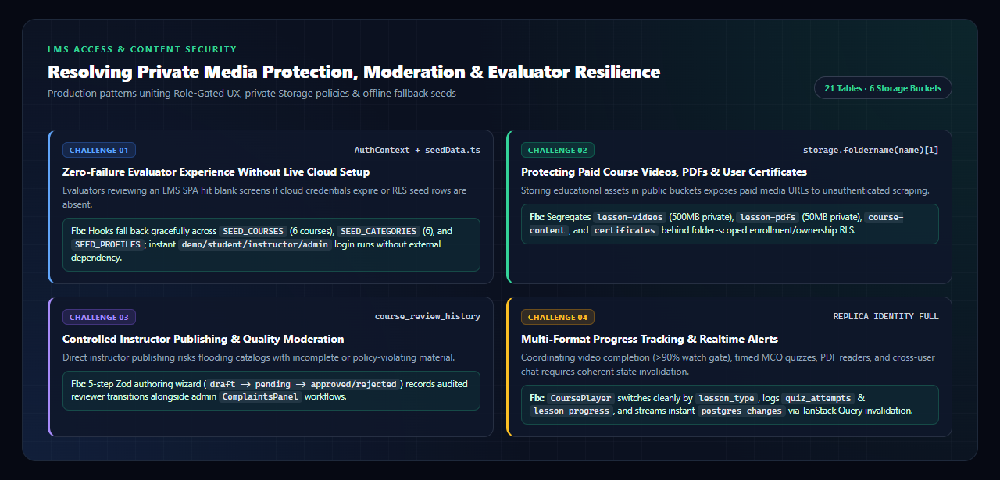
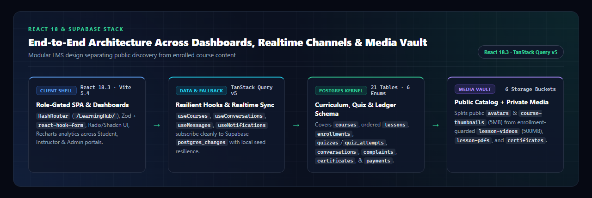
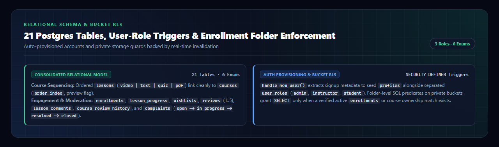
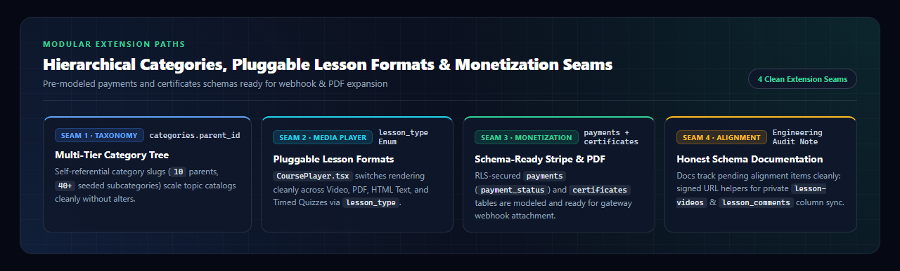

# LearnHub — Enterprise LMS Platform (`React 18.3` + `Supabase` 21-Table Kernel)

**Full-Stack Multi-Role E-Learning Platform (`Student`, `Instructor`, `Admin`) Featuring Private Enrollment-Scoped Storage Buckets, Timed Assessments, Realtime Messaging, Moderation Queues & Offline Evaluator Resilience**

[Live Platform (`LearningHub`)](https://abdulqader-alshihabi.github.io/LearningHub/) &nbsp;|&nbsp; [Problems Solved](#solving-lms-media-protection--evaluator-resilience) &nbsp;|&nbsp; [Architecture & Schema](#architecture--21-table-relational-schema) &nbsp;|&nbsp; [Extensibility](#extensibility-paths--codebase-notes)

---

| System Dimension | Verified Implementation | Engineering Guarantee |
| :--- | :--- | :--- |
| **Client Stack** | `React 18.3.1`, `TS 5.8.3`, `Vite 5.4.19`, `HashRouter`, `TanStack Query v5.83.0` | Code-split multi-role routes across `/dashboard/student`, `/instructor`, `/admin` |
| **UI & Validation** | `Tailwind CSS 3.4.17`, Radix/Shadcn UI, `React Hook Form`, `Zod 3.25.76`, `Recharts` | 5-step Zod course authoring wizard + timed MCQ assessments |
| **Database Schema** | **`21` PostgreSQL Tables** & **`6` Enums** (`app_role`, `course_status`, `lesson_type`) | Auto-provisioned `profiles` + separated `user_roles` via `handle_new_user()` |
| **Storage Governance** | **`6` Storage Buckets** (`lesson-videos` 500MB private, `lesson-pdfs` 50MB private) | Folder-scoped SQL RLS checking `enrollments` & ownership `(storage.foldername)[1]` |
| **Realtime Layer** | `REPLICA IDENTITY FULL` on `messages`, `notifications`, `conversation_participants` | Instant chat threads & notifications invalidating TanStack Query caches |
| **Demo Access** | Instant Evaluator Fallback (`SEED_COURSES`, `SEED_CATEGORIES`, `SEED_PROFILES`) | Functional 1-click evaluator flows even offline or when Supabase credentials expire |

---

## Solving LMS Media Protection & Evaluator Resilience

Building a deployable portfolio LMS introduces four subtle practical problems: evaluators testing a public demo fail immediately if backend keys expire, storing course videos in public buckets leaks paid curriculum assets, unmoderated instructor submissions clutter public catalogs, and multi-format lessons (video, PDF, HTML, quizzes) require unified completion rules.

  

1. **Zero-Failure Evaluator Fallback (`seedData.ts` + `AuthContext.tsx`):** When live queries error or return empty, custom hooks (`useCourses`, `useCourseDetails`, `useCategories`, `CoursePlayer`) fall back cleanly to `SEED_COURSES` (`6` curated courses), `SEED_CATEGORIES` (`6` core categories), and `SEED_PROFILES`. Demo emails (`student@demo.com`, `instructor@demo.com`, `admin@demo.com`) work seamlessly offline via `localStorage` without weakening real Supabase Auth enforcement.
2. **Private Enrollment-Scoped Storage (`20251124210233_...sql`):** Splits public discovery assets (`avatars`, `course-thumbnails` 5MB) from private delivery buckets (`lesson-videos` 500MB, `lesson-pdfs` 50MB, `course-content` 500MB, `certificates` 10MB). PostgreSQL storage policies check `(storage.foldername(name))[1]` against active `enrollments`, instructor ownership, or user UID.
3. **5-Step Authoring & Moderation Audit (`CreateCourse.tsx`, `AdminDashboard.tsx`):** Courses advance cleanly across `course_status` (`draft -> pending -> approved/rejected`), appending immutable reviewer logs into `course_review_history` paired with `ComplaintsPanel` (`open -> in_progress -> resolved -> closed`).
4. **Unified Multi-Format Course Player (`CoursePlayer.tsx`):** Renders `VideoPlayer` (`>90%` completion / `onEnded`), `PDFViewer`, HTML articles, and `QuizPlayer` (countdown `timeLeft`, JSONB options, `quiz_attempts` scoring + automatic next-lesson advancement).

---

## Architecture & 21-Table Relational Schema

  

  

### Key Consolidated Tables (`supabase/migrations/20251124210201_...sql`)

- **Core Identity & Catalog (`6` tables):** `profiles`, `user_roles` (`admin | instructor | student`), hierarchical self-referential `categories` (`parent_id`), `courses`, ordered `lessons` (`order_index` directly under courses), `wishlists`.
- **Learning, Grading & Feedback (`6` tables):** `enrollments`, `lesson_progress`, `quizzes`, `quiz_questions` (`options JSONB`), `quiz_attempts`, `reviews` (`1..5`), `lesson_comments`.
- **Messaging, Moderation & Fulfillment (`8` tables):** `conversations`, `conversation_participants`, `messages`, `notifications`, `complaints`, `course_review_history`, `certificates`, `payments` (`payment_status`).

---

## Extensibility Paths & Codebase Notes

  

- **Ready Extension Seams:** `categories.parent_id` already supports arbitrary hierarchy depth (`10` parents / `40+` subcategories seeded in migrations); `CoursePlayer` switches formats cleanly off `lesson_type`; `payments` and `certificates` tables are already RLS-secured and modeled for Stripe webhook and PDF certificate generation attachment.
- **Verified Engineering Audit Notes:** Transparently documenting minor areas in-repo slated for cleanup: updating `FileUploader.tsx` from `getPublicUrl` to signed URLs when reading private buckets, supplying direct video streams instead of YouTube embed links in offline `seedData.ts`, and aligning legacy field names in `useLessonComments.ts` / `seed.sql` with consolidated migration `20251124210201`.

[Open LearnHub Live](https://abdulqader-alshihabi.github.io/LearningHub/) &nbsp;|&nbsp; [Portfolio](https://abdulqader-alshihabi.github.io/) &nbsp;|&nbsp; [LinkedIn](https://www.linkedin.com/in/abdulqader-alshihabi-859b19260/) &nbsp;|&nbsp; Built by **Abdulqader Alshihabi**

